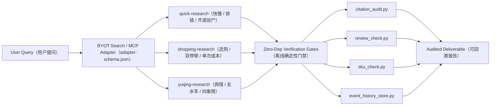

# Research · Shopping · Yuqing Skills

**`quick-research` / `shopping-research` / `yuqing-research` — 循证调研 Agent Skill 套件与零依赖确定性防幻觉核验工具**

[](https://github.com/fisher44123/research-shopping-yuqing-skills/actions/workflows/ci.yml)
[](LICENSE)
[](#60-秒本地离线验证--60-second-offline-demo)
[](#套件全览--whats-included)

**让 AI 调研 Agent「先查证再开口」，并用纯 Python 标准库代码硬拦瞎编编号、裸数字、商品型号张冠李戴与同上下文自己审自己。**
*Evidence-First Agent Skills & Zero-Dependency Deterministic Verification Tools for Deep Research, Product Comparison, and Public Opinion Analysis.*

> [!IMPORTANT]
> **No Scrapers / BYOT Only（无爬虫 · 纯方法论与确定性核验底座）**
> 本仓库**只开源循证调研方法论（Agent Skills）、行为评估集（Evals）与零外部依赖的 Python 确定性核验工具（Tools）**，刻意不包含任何站点爬虫、反爬绕过、Cookie 提取或无头浏览器劫持代码。
> 你可以挂载任何合法搜索 MCP、官方开放 API 或自带检索适配器（**Bring Your Own Tools**），按 [`adapter-schema.json`](skills/quick-research/references/adapter-schema.json) 接入即可无缝跑通整套防幻觉核验流。

---

## 为什么这套 Skill 能治住 AI 调研胡说八道？

纯靠几十行“你是一个严谨研究员”的 Prompt 拦不住大模型的 4 类高频翻车，本仓库直接上**「工作流铁律 + 纯离线确定性代码门禁」**：

| 高频翻车瞬间 | 本套件怎么硬拦？ | 对应模块 |
| :--- | :--- | :--- |
| 报告正文现编 `[SRC-099]`，或挂真编号却文不对题 | 正文编号全量对账注册表 + 上下文词项重合度预警 | [`citation_audit.py`](tools/citation_audit.py) |
| 瞎写「并发提升 380%」「已实锤」，旁无任何出处凭证 | 外置 JSON 规则硬拦裸统计数字与无凭证宣称（exit 1） | [`review_check.py`](tools/review_check.py) |
| 比价把 `小米14 Pro` / `12+512` 算进 `小米14 256GB` | 字段级硬拆品牌/型号/后缀/代次/容量 + 单次成本精算 | [`sku_check.py`](tools/sku_check.py) |
| 模型在同段对话自问自答盖章“审核通过”、覆写旧舆情 | 强制上下文隔离台账 + SQLite 证据哈希事务持久化 | [`review_log.py`](tools/review_log.py) / [`event_history_store.py`](tools/event_history_store.py) |

---

## 实测终端拦截效果图（60 秒离线 Demo 真实输出）

跑一遍 `python demo/run_demo.py`，直接看机器怎么当场抓出故意埋在报告里的 AI 幻觉、跨型号比价错配与包装税陷阱：

```text
========================================================================
[1/4] citation_audit.py —— 抓编造 SRC 编号与文不对题引用
========================================================================
| 编造或越界编号 | 1 | 🔴 需核 |
| 引用上下文与证据重合度过低 | 1 | ⚠️ 需核 |
- 🔴 以下编号不在本轮注册表，引用前必须核实来源：`SRC-099`
- ⚠️ 引用了真编号，但上下文与被引证据几乎不重合：`SRC-002` L11（重合 0%）

========================================================================
[2/4] review_check.py --strict —— 硬拦裸统计数字与无凭证声称
========================================================================
  ❌ 硬拦        数字带来源标注            5 个统计量中 4 个附近无来源（80%，阈值 30%）；例：L7「380」; L7「85」; L7「12」
  ❌ 硬拦        声称类有可复跑凭证          自称已实锤 无凭证
  ⚠️ 提示       越级词有证据支撑           「唯一可靠 100%」仅 0 处来源
硬拦 FAIL 2 项：数字带来源标注、声称类有可复跑凭证 ｜ 提示 WARN 3 项

========================================================================
[3/4] sku_check.py —— 字段级防张冠李戴与单次成本精算
========================================================================
目标：小米 14 12GB 256GB 黑色
  ✅ 同款 3799 ｜ 自营频道 小米14 12GB+256GB 黑色 官方标配 3799元
  ❌ 不同型号 3599 ｜ 第三方补贴 小米14 12+512 黑色 ｜ 容量不一致（12GB/256GB ≠ 12GB/512GB）
  ❌ 不同型号 4299 ｜ 品牌店 小米14 Pro 12GB 256GB 黑色 ｜ 版本后缀不一致（无 ≠ pro）
  ❌ 不同型号 4499 ｜ 官方旗舰 小米15 12GB 256GB 黑色 ｜ 系列数字不一致（14 ≠ 15）
  ❔ 判不出 1999 ｜ 清仓特价 5G旗舰手机 黑色 ｜ 缺强字段

--- 复合规格折算与单次成本演示（25g/次） ---
  大包装 500g*2袋 (¥29.9) -> 总重 1000.0g | 单次 ¥0.748 | 折合 ¥14.95/斤
  小包装 500g桶装 (¥19.9) -> 总重 500.0g | 单次 ¥0.995 | 折合 ¥19.90/斤
  成本对比：贵的那款单次要 0.995 元，便宜这款 0.748 元，差 1.33 倍。
```

---

## 10 秒一键接入你的 AI Agent（Claude Code / Cursor / Codex / Antigravity）

```bash
# 1. 克隆仓库到本地
git clone https://github.com/fisher44123/research-shopping-yuqing-skills.git
cd research-shopping-yuqing-skills
```

将 `skills/` 下的三个目录（`quick-research`、`shopping-research`、`yuqing-research`）复制到你当前 AI 工具的 Skills 目录即可自动按意图路由触发（推荐同时把 `tools/` 带在项目根目录或工作区供 Agent 调用校验）：

- **Claude Code**：复制到 `~/.claude/skills/` 或项目 `.claude/skills/`
- **Codex / Antigravity / 其他 `SKILL.md` 兼容客户端**：复制到对应的全局 `skills/` 目录

### 3 条可直接粘贴测试的实战指令

1. **触发 `quick-research`（开源选型 + 三维验尸 + 反向退坑）**：
   > 「用 `quick-research` 帮我对比两个开源 Agent 编排框架的优缺点，必须查 GitHub 最近真实提交、归档风险与社区退坑反馈，所有数字挂来源并用 `tools/` 脚本校对。」
2. **触发 `shopping-research`（消费品认知校准 + 双停顿 + 单次使用成本）**：
   > 「用 `shopping-research` 帮我挑一款家用除湿机或高频清洁耗材，先按流程做品类认知校准与无品牌关键词确认，再用 `sku_check.py` 算清不同包装的单次使用成本。」
3. **触发 `yuqing-research`（舆情血统画像 + 水军去噪 + 四象限）**：
   > 「用 `yuqing-research` 梳理某品牌近期软件更新后的真实口碑，区分官媒/KOL/散户血统、海内外分盘统计，并按四象限输出带引用编号的评价分布。」

---

## 核心架构流程 / Architecture



---

## 60 秒本地离线验证 / 60-Second Offline Demo

全部测试和校验脚本均仅依赖 **Python 3.10+ 标准库**，无需 `pip install` 任何包，也不访问外网：

```bash
# 1. 运行 60 秒幻觉拦截演示
python demo/run_demo.py

# 2. 运行全套离线单元测试（覆盖 SKU 边界、防自审、引用稽核与 SQLite 事务）
python -m unittest discover -s tests -v

# 3. 运行隐私与零爬虫红线扫描
python scripts/privacy_audit.py
```

---

## 套件全览 / What's Included

### 1. 三套渐进式方法论 Skill（[`skills/`](skills/)）

| Skill 目录 | 定位与触发场景 | 内建关键机制 | 入口文件 |
| :--- | :--- | :--- | :--- |
| `quick-research` | 通用技术排错、选型、事实验证 | Via Negativa 退坑必查、开源三维验尸、Fail-Fast | [`SKILL.md`](skills/quick-research/SKILL.md) |
| `shopping-research` | 消费品选购、长期耗材/耐用件比价 | 物理真身校准、L1/L2 双停顿矩阵、单次/日均成本 | [`SKILL.md`](skills/shopping-research/SKILL.md) |
| `yuqing-research` | 品牌风评、事件反转与海内外舆论温差 | 血统分层、海内外分盘、3-Gram 去水军、四象限 | [`SKILL.md`](skills/yuqing-research/SKILL.md) |

### 2. 四个确定性离线核验工具（[`tools/`](tools/)）

| 脚本 / 配置 | 解决的问题 | 典型 CLI 调用 |
| :--- | :--- | :--- |
| `citation_audit.py` | 校验正文 `SRC-xxx` 是否存在于注册表及上下文重合度 | `python tools/citation_audit.py rep.md --registry reg.json --strict` |
| `review_check.py` | 按 [`review_rules.json`](tools/review_rules.json) 硬拦裸数字、空口宣称与越级词 | `python tools/review_check.py rep.md --strict` |
| `sku_check.py` | 拆解品牌/型号/Pro后缀/代次/容量/复合装并算单次成本 | `python tools/sku_check.py --target "..." --cands-json c.json --dose 25g --strict` |
| `event_history_store.py` | SQLite 事务落盘原始事件、SHA-256 哈希与 `source_health` | Python 模块导入 `EventHistoryStore` |

---

## English Overview

**`research-shopping-yuqing-skills`** is a modular **Agent Skill suite** + **zero-dependency deterministic verification toolkit** built for **deep research**, **product/price comparison**, and **public opinion analysis** (`quick-research`, `shopping-research`, `yuqing-research`).

Instead of bundling fragile platform scrapers that constantly break under anti-bot updates, this repo decouples **retrieval** (**BYOT — Bring Your Own Tools** via [`adapter-schema.json`](skills/quick-research/references/adapter-schema.json)) from **methodology & verification**:

- **Hallucination & Citation Guardrails**: `citation_audit.py` catches invented `[SRC-xxx]` IDs and detects citations placed next to unrelated claims; `review_check.py` enforces externalized JSON rules (`review_rules.json`) so unsourced metrics and unbacked verification claims fail deterministically (`--strict`).
- **Deterministic SKU Alignment & Unit Cost Math**: `sku_check.py` extracts brand aliases, model tokens, edition suffixes (`Pro`, `Max`, `V2`/`V3`), storage tiers (`12+512`), and compound pack weights (`500g*2`) to block cross-model price pollution and compute exact cost-per-use.
- **Anti-Shill & Dual-Region Opinion Auditing**: `yuqing-research` enforces domestic vs. international separation, source-lineage breakdown (`official` / `creator` / `grassroots`), 3-Gram Jaccard shill filtering, and atomic SQLite event persistence via `event_history_store.py`.
- **Behavioral Evals & Privacy CI**: Includes sanitized trigger/output eval suites (`evals/`), a 60-second offline demo (`demo/run_demo.py`), full `unittest` coverage (`tests/`), and an automated leak scanner (`scripts/privacy_audit.py`).

For AI coding assistants & LLM discovery indexes, see [`llms.txt`](llms.txt).

---

## 欢迎共建与 Star 支持

如果这套**「方法论 + 确定性代码门禁」**帮你的 AI Agent 少编了几次瞎话、多拦下几回买错型号，欢迎点一颗 **Star**，也欢迎提交 Issue / PR 一起把审核规则和评估题库喂得更准（贡献规则见 [`CONTRIBUTING.md`](CONTRIBUTING.md)，明确拒收爬虫代码）：

- 欢迎提交：**AI 调研真实翻车文本样本**、**易混淆商品型号 / 复合包装用例**、**`evals/` 回归测试题**、**合法官方 API 的 `adapter-schema.json` 适配示例**。
- 协议授权：[Apache License 2.0](LICENSE)。
